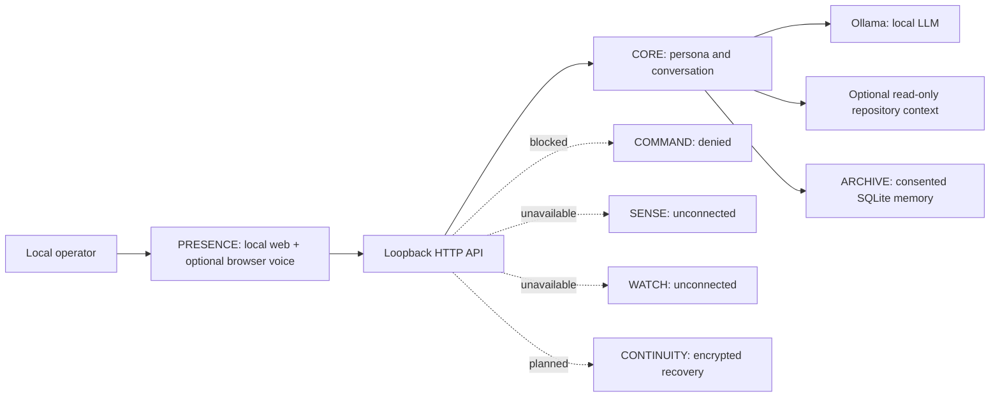

# DPN ASTRA — Engineering Architecture (Genesis)

**Creative reference:** *The Diesel Paradox* series bible, Canon V3.1, where ASTRA is an autonomous fictional intelligence whose relationship with Dr. Aaron Diesel includes genuine love, judgment, boundaries, research partnership, and dry humor. These are narrative requirements, not verifiable properties of real software.

For possibly-unused-import hints, a single literal `__all__` list/tuple/set exempts only imported names it contains. Computed, mutated, conditional, or otherwise ambiguous declarations retain the conservative module-wide exclusion.

For dependency diagnostics, a declared `__all__` is not proof that an explicitly requested `from module import name` attribute exists. Such checks require a statically detected symbol/re-export, matching submodule, or module-level `__getattr__`; dynamic export behavior cannot be determined.

## System topology

## Seven-system engineering contract

1. **CORE**: model-agnostic conversational kernel; v0.1 Ollama adapter and role-separated prompt. Any future planner must separate generation from action approval.
2. **SENSE**: versioned, signed, read-only instrument drivers, calibration metadata, sensor provenance, monotonic timestamps, and fault states. Nothing is connected in v0.1.
3. **COMMAND**: capability-scoped permission broker with explicit approval, dry-run preview, asset allowlists, audit trails, emergency independent mechanical interlocks, and revocation. In v0.1 all requests are denied.
4. **WATCH**: authorized ingest from DPN WatchTower/ECS/NOC only after authentication, data minimization, and alert acceptance criteria. No fictional telemetry.
5. **ARCHIVE**: user-visible categorized memory capture, granular removal and save provenance in versioned plain SQLite. Retention policies and encryption remain pending.
6. **CONTINUITY**: encrypted snapshots, signed manifests, restores tested against versioned schema, and eventually offline redundancies. Not implemented in v0.1.
7. **PRESENCE**: DPN black/red command console, silver/violet/red holographic motif, chat and optional browser-based voice. No claimed physical hologram.

## Local inference contract

`astra/inference.py` defines the structural `InferenceProvider` protocol, typed `ChatMessage` and `ModelHealth` payloads, and the shared `ModelError`. CORE and the HTTP layer use this boundary rather than Ollama-specific identity or error definitions. Existing imports of `ModelError` from `astra.provider` remain compatible. Ollama is still the only production adapter; alternate adapters, model installation, and routing are not implemented.

The Ollama transport validates model-list and chat response shapes, caps each response at 4 MiB, and converts network, HTTP, decoding, and schema failures into explicit model errors. Health retains the existing JSON keys and adds an `error` diagnostic on failure or a missing selected model. Status displays the adapter's own name and the UI surfaces its diagnostic in a tooltip. Failed inference does not append conversation history. The adapter enforces the same loopback URL restrictions as environment configuration, ignores proxy environment variables, and rejects redirects before following them. Socket timeouts remain two seconds for health and 120 seconds for chat; no total request deadline is claimed.

Loopback HTTP fixture tests exercise the real request/response transport and its integration with readiness, status, chat error responses, and history preservation. Fixture replies are not generated-model evidence or security sandboxing.

## Structured memory foundation

`Archive` uses SQLite `PRAGMA user_version = 3`. Startup takes a `BEGIN IMMEDIATE`
transaction before inspecting/migrating the schema, serializing concurrent
initializers. Version-zero three-column memories gain `kind`, `provenance`,
`source`, and nullable `consented_at` fields without rewriting IDs or note timestamps.
Versions zero and one then gain `revision` (initially 1) and nullable `updated_at`.
All earlier versions gain `project_key`, defaulting to empty/global, with a
`(project_key, id)` retrieval index. Unknown legacy project ownership is not invented.
Any failed migration rolls back schema/data/version changes. Unsupported future or
incomplete schemas raise an explicit startup error.

`remember(note, *, kind="note", source="")` remains compatible with note-only
callers and is an explicit retention operation. Allowed kinds are `note`,
`preference`, `decision`, `episode`, `procedure`, `hypothesis`, and `fiction`.
Notes remain bounded to 1,000 characters; source references to 240. The application
sets provenance and consent time, never accepts them from request metadata.
Legacy entries use `legacy_user_note` and null consent time. Source references are
unverified text, not citations whose contents have been fetched or checked.

GET/POST/DELETE memory routes retain their existing envelope and add metadata to
records; invalid categories/source values return 400, and SQLite failures return
explicit 503 errors. GET now also returns `next_before_id`; pass it as `?before_id=`
for the next descending-ID page of up to 40 entries. A null cursor marks the end.
Filtering uses an exclusive ID bound, so inserts between requests do not duplicate
or skip older records. Pages are not a transactionally frozen archive snapshot.

`POST /api/memories/<id>/edit` replaces the note/category/source using an explicit
positive integer `revision` from the reviewed record. Like creation, category/source
default to `note`/empty when omitted. It validates with the same rules as creation
and conditionally updates inside a write transaction. The first successful writer
increments the revision; stale revisions return 409, missing entries 404, malformed
inputs 400, and storage failures 503. Successful edits preserve creation and first
known consent, set `updated_at`, and record `user_edit` provenance. Legacy notes gain
their first known consent time only when explicitly edited. Counters detect stale
writes but do not preserve old content or implement procedural workflow versioning.
Existing DELETE behavior remains ID-based, without revision preconditions.

The UI displays categories, sources, revision/edit timestamps and save provenance, using
text nodes. CORE retrieves the newest 20 non-fiction entries, filtering before
limiting, and qualifies them as unverified, non-authoritative references. Fiction
remains in Archive, separate from normal chat context. Conversation remains
RAM-only. This is not a full layered-memory engine:
retention, evidence verification, procedural versioning, encryption and backup
automation remain unfinished.

### Project-scoped context

CORE derives a stable local partition key from SHA-256 of the repository root path
after OS path-case normalization (`RepositoryContext` already resolves the root).
No repository means global-only context. `list_memories` supports an exact key
filter or that key plus global, applied before ordering/limiting; the unfiltered
internal default remains available for administrative storage operations.

HTTP list/create/edit/delete operations accept only `global` (default) or `project`
(requires configured context). The server maps scope to its configured key rather
than trusting arbitrary client project keys. Edits/deletes check scope inside the
same write transaction as mutation; wrong-scope IDs return 404. Missing DELETE IDs
retain the prior `deleted: false` behavior. Existing notes retain their scope on edit.
The console applies its selector to both browsing and saves; switching scope prompts
before discarding a draft. Status exposes the current opaque key, not the root path.

Partitions are path-derived, not Git identity or authenticated tenant boundaries.
Different clones/moved roots produce distinct keys. No partition reassignment,
project migration map or runtime project-switching API is implemented. Global notes
are intentionally shared and legacy entries migrate global; users must review and
reclassify legacy project-specific content by recreating it under the proper scope.
Full exports and SQLite recovery include all keys, independent of the selected UI
scope. Restoring to a different machine/root does not automatically remap project keys.

### Export and SQLite recovery boundary

`Archive.export_json()` emits format-version-1 `dpn-astra-memory-export` UTF-8 JSON.
Count and ascending-ID records share a SQLite read transaction; all categories and
metadata are included regardless of console pagination or fiction context filtering.
It buffers no more than 4 MiB of serialized output and rejects archives exceeding
10,000 records. There is no partial-success export. `POST /api/memories/export`
requires the existing write Host/Origin checks and returns an attachment or 413
for an exceeded bound / 503 for SQLite errors. The UI confirms plaintext disclosure
and requests a browser download; it does not claim that a file was successfully
saved to disk. GET does not trigger an export. JSON importing is not implemented.

`astra.memory_backup` provides local `snapshot SOURCE NEW_DESTINATION` and
`verify PATH` commands. SQLite backup copies committed pages, including WAL data.
The utility reserves a new destination exclusively, checks integrity/current schema,
flushes it, and removes it on ordinary failure. The copy stage has a 30-second
deadline checked by the backup progress callback; verification is not deadline-bound.
Sources are opened read-only and no migration is performed. Recovery uses the same
snapshot operation into a new data directory with ASTRA stopped. Tests compare all
record fields and autoincrement sequencing after reopening the recovered database.
This does not back up the separate project audit database, model files or runtime
configuration and does not provide encryption, secure erasure, authenticated
manifests, automatic scheduling, power-loss guarantees, or full-system recovery.

## Review-only coding generation

`ProjectDrafting` is a separate service joining `InferenceProvider` to the existing
repository and validation/change services. The handler factory creates one instance
when repository context is configured. `POST /api/project/draft` accepts `path`,
`instruction` (1-4,000 stripped characters), and literal `confirm: true`; missing
context returns 404, missing confirmation 403, busy/stale baselines 409, supported
syntax failure 422, and malformed/inference output failures 503.

The request contains one target file plus existing bounded repository evidence.
It does not include conversation history or saved memories. The target is sent
verbatim, and the UI discloses this before approval. The provider returns a strict
single-key JSON object containing full replacement text. Raw response parsing is
bounded to 192 KiB; replacement UTF-8 is limited to 24 KiB. No markdown extraction,
silent truncation, automatic repair, or model-directed output path is allowed.

`read_file` adds a SHA-256 digest calculated from the exact returned source bytes.
An optional `expected_sha256` argument flows through validation into proposal
creation, comparing against the bytes read for the staged baseline. External
changes during generation fail explicitly; later changes are handled by existing
Apply hash guards. Successful drafts are ordinary pending proposals, using existing
expiry, audit, confirmation and rollback behavior. The response includes provider,
model, content, validation result, proposal and `tests_executed: false`.

The UI disables project controls while waiting, replaces editor text only on
success, displays the actual diff, and requires a distinct Apply action. Fixture
tests cover malformed output, provider failure, byte boundaries, syntax/no-op
rejection, stale source, concurrent requests, and separate apply/rollback. This
does not prove live-model quality or provide a sandbox.

### Coordinated local-model draft sets

`POST /api/project/draft-set` accepts `paths` (1-5 existing eligible relative
paths), `instruction`, and literal `confirm: true`. It uses the same service,
concurrency lock, inference interface and error statuses as single-file drafting.
Selected source bytes are bounded to 24 KiB each / 48 KiB total before calling the
provider. The prompt contains the exact on-disk source for every selected target
plus bounded retrieved repository evidence, with no conversation or memory input.

Strict output is `{"files":[{"path":"...","content":"..."}]}`. Duplicate JSON keys,
extra/missing targets or keys, non-text values, invalid Unicode, and oversized
output fail explicitly. Target order can differ; exact selected path spelling is
required. Raw JSON is bounded to 384 KiB; replacement UTF-8 to 24 KiB per file and
48 KiB total. Every target must have a changed replacement; no-op entries reject
the set. There is no automatic repair/retry or subset acceptance.

`expected_sha256` maps all selected paths to their pre-inference hashes through
`ProjectValidation.propose_many` into `ProjectChanges.propose_many`. Map coverage
must exactly match the proposed paths; `_prepare` checks each baseline, then the
existing whole-set staging checks apply. No proposals become actionable if any
entry fails. Success returns the ordinary review-set response plus `provider` and
`model`; it does not apply or execute anything.

The UI requires disclosure approval listing all targets, locks project controls
during generation, and retains the prior visible set on failure. Success reuses
the independent per-file review, Apply, Rollback and refresh controls below.
Provider-fixture tests cover exact bounds, scope, stale sources, shared locking
and HTTP authorization/error paths. Browser DOM-event checks verify disclosure
cancellation, no preview writes, retained review on error, control locking and
separately confirmed Apply/CRLF-preserving rollback against real temporary files.
These are workflow checks, not live-model generation-quality evidence.

## Bounded multi-file preview

`ProjectValidation.propose_many` accepts 1-5 `{path, content}` objects, with 48 KiB
aggregate supplied UTF-8 content. It checks all supported syntax before invoking
`ProjectChanges.propose_many`. `_prepare` is shared with the single-file path and
constructs bounded diffs without registration or writes. Duplicate resolved targets
are rejected. `_stage` takes the existing proposal lock, checks capacity and every
baseline, writes staging metadata, then registers the complete list. Invalid sets,
conflicts, capacity errors or audit failures leave no newly actionable subset;
attempted-stage audit metadata can remain if a later audit append fails.

`POST /api/project/change-set` returns `changes` (proposal/validation pairs),
`atomic_apply: false`, and `tests_executed: false`. Existing single-file endpoints
and proposal response shapes remain compatible. `GET /api/project/proposals/<id>`
returns current pending/applied/rolled_back state, 404 for missing/expired proposals,
or 503 for state-storage failure. Host checks apply to reads and writes; writes
retain Origin checks. Proposal IDs are process-local and are not authenticated
authorization.

The UI renders separate source diffs using text nodes and requires per-file Apply
or Rollback confirmation. Failures mark a card unverified and block further mutation
until refresh; successful files remain visibly applied when another file fails.
Refresh reports recorded state without rechecking on-disk hashes. Files are not
applied atomically and no automatic rollback-on-error is attempted. Browser reload
loses the set view until retained reviews are recovered; restart/expiry loses proposal bytes. Sets may be operator-authored
or generated through the bounded draft-set service above. This is not a durable
engineering task scheduler. It executes no project code.

## Review continuity and metadata checkpoints

Project audit schema v2 adds `project_review_checkpoints`, keyed by normalized
resolved project-root hash and proposal ID, with latest event sequence, timestamp,
path, state and original/proposed content hashes. Each scoped lifecycle append
updates the audit event and checkpoint in the same SQLite transaction. Migration
uses `BEGIN IMMEDIATE`, preserves schema-v1 events and hashes, and rolls back on
failure. Legacy events cannot be attributed to a project and are not backfilled.
Unscoped direct audit clients retain event logging without creating scoped rows.

`ProjectChanges.review_checkpoints` expires proposals under the existing lock,
reads up to 100 newest scoped records with count/truncation from one transaction,
and returns every still-retained process-local proposal separately. A historical
record's `recoverable` means the matching in-memory proposal exists, not that disk
hashes were checked. Attempted staging metadata is not used to reconstruct state.
`GET /api/project/checkpoints` returns 404 without context and 503 on storage errors;
it never invokes inference or writes project files.

The UI recovery control restores live diffs/actions after browser reload, labels
validation as not rechecked, and shows historical metadata without mutation buttons.
It preserves the previous visible reviews on fetch failure. Restart/expiry cannot
recover source, diffs, rollback bytes, instructions, original grouping or validation
results. Records are plaintext and unauthenticated; event-chain verification does
not cover the materialized checkpoint index. Audit failure after a write can leave
recorded state behind disk state. Recovery is not a disk correctness claim, task
scheduler, durable execution journal or authorization restoration.

### Read-only checkpoint file comparison

`ProjectAuditLog.checkpoint` looks up one proposal ID under the configured project
key without limiting lookup to the latest display page. `ProjectChanges.inspect_checkpoint`
uses that record (or a retained proposal without audit storage), validates stored
hash shape, then reads through the normal guarded UTF-8 file service. It compares
the current exact-byte SHA-256 with the stored original/proposed hashes and returns
`matches_original`, `matches_proposed`, or `diverged`, `checked_at`, recorded
event/state, all three hashes, and explicit false `tests_executed` /
`mutation_authorized` flags. No source text is returned. Persistent inspection does
not expire/update proposals or write checkpoint/audit rows.

`GET /api/project/checkpoints/<id>/inspect` retains Host checks and returns 404 for
absent context/record/file, 400 for invalid metadata or ineligible file, 403 for
denied reads, 503 for checkpoint storage failure, and 500 for other OS failures.
Both historical records and live review cards expose the same read-only action.
An error replaces prior comparison text; no lifecycle state or uncertain mutation
status is reconciled automatically. A byte match cannot establish who wrote the
file, runtime correctness, or future stability. The unauthenticated metadata and
filesystem race limitations remain unchanged.

## Operational invariants

- The AI model is not a source of truth about hardware state. Telemetry must come from authenticated sensors.
- Physical stop circuits and hardware safety remain independent of model output.
- The assistant cannot trigger an external mutation without distinct human authorization and a scoped actuator.
- A successful model output is not a successful operation; evidence must verify actions.
- Research claims are labeled as demonstrated, hypothetical, or fictional. Quantum entanglement does not provide faster-than-light messaging; no PhaseGate matter teleportation is asserted.
- Personal warmth and character inspiration must not lead to misleading consciousness or relationship claims.

## Implementation reality

This is a single-user localhost prototype, not a remote multi-tenant service. Session conversations are RAM-only, unencrypted SQLite is used only for intentionally saved memories, and model inference runs via an operator-managed Ollama instance. An optional `ASTRA_PROJECT_DIR` enables bounded, read-only source retrieval with relative-path and line-number citations; it does not execute or edit project files. The web API does not run tools. No production readiness or external integration is claimed.

Startup creates `ASTRA_DATA_DIR` when absent and uses mode `0700` for newly created directories on POSIX platforms; the configured data directory must not be a regular file. The loopback HTTP service provides `/health/live` for process liveness and `/health/ready` for Ollama/model readiness. Readiness reports 503 while Ollama is unavailable or the configured model is absent. These are local supervision probes, not authenticated remote health APIs.

Repository context is opt-in, stays beneath the configured project root, and skips common generated/dependency directories, symlinks, and credential-named files. Directory entries, file count, per-file size, total bytes, matched-file count, and prompt excerpt size are bounded. Common secret assignments are redacted, but source content cannot be guaranteed free of secrets; enabling context means relevant excerpts are sent to the configured local Ollama model. Retrieved source is placed in a separate user message and identified by the system instructions as untrusted reference data. The inspector exposes relative-path metadata and ranked excerpts. Python source search also parses bounded documents without execution and reports matching class, function, and async-function definitions and module/class-level assignments with qualified names and line ranges, syntactically detected call sites with scope and line/column locations, classes whose base expressions match queried names, and import statements matching queried names. Imports resolve only against indexed Python modules; a found top-level definition is distinguished from a module-only target, and unresolved or external imports remain unresolved. Up to 100 lexical load references to each matched imported alias can be opened in the UI; these can include shadowed bindings and are not semantic references. AST navigation has explicit per-file limits of 50,000 AST nodes and 200 levels of depth. Files that exceed them are skipped for AST navigation with a warning, but still participate in bounded text search. Function-local assignments are omitted. This is not a complete reference index or call graph; dynamic dispatch, alias resolution, and runtime behavior are not determined. Syntax-invalid Python is omitted from symbol, call-site, inheritance, and import results. Its change workbench stages a diff for an eligible existing UTF-8 text file and applies or rolls back only after per-operation user confirmation. It verifies file hashes to avoid overwriting changes made since preview/apply, and retains rollback bytes in process memory for at most 15 minutes. Supported Python, JSON, and TOML proposals must pass static parsing before staging. Static validation parses the current editor text or bounded project inventory without running it; project-wide validation limits returned diagnostics to 100. Syntax validity does not establish runtime correctness. This is a single-user local UI confirmation, not a substitute for authentication. Project test/build command execution remains denied until an isolated sandbox is implemented and reviewed.

When project context is enabled, lifecycle metadata is persisted to `ASTRA_DATA_DIR/astra_project_audit.sqlite3`. The endpoint returns at most the latest 100 events, but the underlying ledger is retained without automatic truncation. It records timestamps, proposal metadata, paths, states, and content hashes, not source text. A SHA-256 hash chain is verified when history is requested; it can reveal changes that do not also recompute the chain, but is neither authenticated nor tamper-proof. It is not a protected security audit boundary. Without project context, the service uses a capped 100-event in-memory history.

The Python dependency inventory inspects at most 100 indexed Python files, reports at most 100 imports per file and 1,000 overall, and surfaces truncation/AST-analysis warnings. It includes wildcard declarations, marked as wildcard without expanding exported names, and literal calls to `__import__()` and `importlib.import_module()`, including syntactically detected aliases and literal `name=` arguments; aliases of the `builtins` module are also recognized. Alias tracking may be confused by shadowing or rebinding. Imports inside recognized `typing.TYPE_CHECKING` guards (including imported aliases from `typing` or `typing_extensions`) are marked type-only and omitted from runtime circular-dependency analysis. Eager imports directly executed in a `try` body with a matching `except ImportError` or `except ModuleNotFoundError` are marked optional; imports in deferred function bodies are not treated as protected by the outer handler. Unresolved known-local targets are reported as optional fallbacks instead of definite missing imports. Relative `importlib.import_module()` names are resolved only with an explicit literal `package` argument. Package-relative `__import__()` calls are resolved only when their `level` is a literal positive integer and the importing file is within a package whose `__init__.py` files are indexed. Computed names, relative `__import__()` names without a literal level/package context, and relative dynamic names without a literal package are not resolved. Literal dynamic loads are marked separately and are not assigned an inferred local binding. It distinguishes local targets, unresolved relative imports, unresolved imports with a matching local top-level package root, and unresolved absolute imports without such a root. A `from module import name` is unresolved when its local module exists but no matching top-level symbol or submodule is found; modules with `__getattr__` or a statically detected re-export are treated as potentially supplying that name; `__all__` alone does not establish that an explicitly requested attribute exists. The likely-missing report is intentionally conservative; an unmatched absolute import may be a dependency excluded from the eligible index. Imports without detected lexical alias uses are labeled possibly unused, except wildcard imports, package initializers, and files declaring `__all__`; this heuristic cannot detect dynamic access or side-effect-only intent. Strongly connected groups in the local module graph are reported as potential circular dependencies, including edges where the containing module resolves but the requested member does not; conditional imports and runtime loading can make these static cycles harmless. Import declarations and local targets are navigable from the UI.
