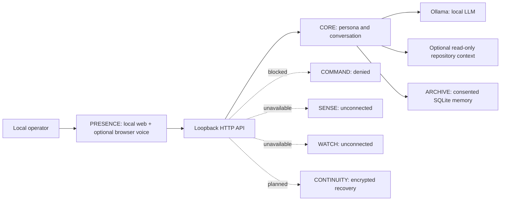

# DPN ASTRA — Engineering Architecture (Genesis)

**Creative reference:** *The Diesel Paradox* series bible, Canon V3.1, where ASTRA is an autonomous fictional intelligence whose relationship with Dr. Aaron Diesel includes genuine love, judgment, boundaries, research partnership, and dry humor. These are narrative requirements, not verifiable properties of real software.

For dependency diagnostics, a declared `__all__` is not proof that an explicitly requested `from module import name` attribute exists. Such checks require a statically detected symbol/re-export, matching submodule, or module-level `__getattr__`; dynamic export behavior cannot be determined.

## System topology

## Seven-system engineering contract

1. **CORE**: model-agnostic conversational kernel; v0.1 Ollama adapter and role-separated prompt. Any future planner must separate generation from action approval.
2. **SENSE**: versioned, signed, read-only instrument drivers, calibration metadata, sensor provenance, monotonic timestamps, and fault states. Nothing is connected in v0.1.
3. **COMMAND**: capability-scoped permission broker with explicit approval, dry-run preview, asset allowlists, audit trails, emergency independent mechanical interlocks, and revocation. In v0.1 all requests are denied.
4. **WATCH**: authorized ingest from DPN WatchTower/ECS/NOC only after authentication, data minimization, and alert acceptance criteria. No fictional telemetry.
5. **ARCHIVE**: user-visible memory capture, granular removal, provenance and retention policy. In v0.1 explicit notes only, plain SQLite on the host.
6. **CONTINUITY**: encrypted snapshots, signed manifests, restores tested against versioned schema, and eventually offline redundancies. Not implemented in v0.1.
7. **PRESENCE**: DPN black/red command console, silver/violet/red holographic motif, chat and optional browser-based voice. No claimed physical hologram.

## Operational invariants

- The AI model is not a source of truth about hardware state. Telemetry must come from authenticated sensors.
- Physical stop circuits and hardware safety remain independent of model output.
- The assistant cannot trigger an external mutation without distinct human authorization and a scoped actuator.
- A successful model output is not a successful operation; evidence must verify actions.
- Research claims are labeled as demonstrated, hypothetical, or fictional. Quantum entanglement does not provide faster-than-light messaging; no PhaseGate matter teleportation is asserted.
- Personal warmth and character inspiration must not lead to misleading consciousness or relationship claims.

## Implementation reality

This is a single-user localhost prototype, not a remote multi-tenant service. Session conversations are RAM-only, unencrypted SQLite is used only for intentionally saved facts, and model inference runs via an operator-managed Ollama instance. An optional `ASTRA_PROJECT_DIR` enables bounded, read-only source retrieval with relative-path and line-number citations; it does not execute or edit project files. The web API does not run tools. No production readiness or external integration is claimed.

Repository context is opt-in, stays beneath the configured project root, and skips common generated/dependency directories, symlinks, and credential-named files. Directory entries, file count, per-file size, total bytes, matched-file count, and prompt excerpt size are bounded. Common secret assignments are redacted, but source content cannot be guaranteed free of secrets; enabling context means relevant excerpts are sent to the configured local Ollama model. Retrieved source is placed in a separate user message and identified by the system instructions as untrusted reference data. The inspector exposes relative-path metadata and ranked excerpts. Python source search also parses bounded documents without execution and reports matching class, function, and async-function definitions and module/class-level assignments with qualified names and line ranges, syntactically detected call sites with scope and line/column locations, classes whose base expressions match queried names, and import statements matching queried names. Imports resolve only against indexed Python modules; a found top-level definition is distinguished from a module-only target, and unresolved or external imports remain unresolved. Up to 100 lexical load references to each matched imported alias can be opened in the UI; these can include shadowed bindings and are not semantic references. AST navigation has explicit per-file limits of 50,000 AST nodes and 200 levels of depth. Files that exceed them are skipped for AST navigation with a warning, but still participate in bounded text search. Function-local assignments are omitted. This is not a complete reference index or call graph; dynamic dispatch, alias resolution, and runtime behavior are not determined. Syntax-invalid Python is omitted from symbol, call-site, inheritance, and import results. Its change workbench stages a diff for an eligible existing UTF-8 text file and applies or rolls back only after per-operation user confirmation. It verifies file hashes to avoid overwriting changes made since preview/apply, and retains rollback bytes in process memory for at most 15 minutes. Supported Python, JSON, and TOML proposals must pass static parsing before staging. Static validation parses the current editor text or bounded project inventory without running it; project-wide validation limits returned diagnostics to 100. Syntax validity does not establish runtime correctness. This is a single-user local UI confirmation, not a substitute for authentication. Project test/build command execution remains denied until an isolated sandbox is implemented and reviewed.

When project context is enabled, lifecycle metadata is persisted to `ASTRA_DATA_DIR/astra_project_audit.sqlite3`. The endpoint returns at most the latest 100 events, but the underlying ledger is retained without automatic truncation. It records timestamps, proposal metadata, paths, states, and content hashes, not source text. A SHA-256 hash chain is verified when history is requested; it can reveal changes that do not also recompute the chain, but is neither authenticated nor tamper-proof. It is not a protected security audit boundary. Without project context, the service uses a capped 100-event in-memory history.

The Python dependency inventory inspects at most 100 indexed Python files, reports at most 100 imports per file and 1,000 overall, and surfaces truncation/AST-analysis warnings. It includes wildcard declarations, marked as wildcard without expanding exported names, and literal calls to `__import__()` and `importlib.import_module()`, including syntactically detected aliases and literal `name=` arguments; aliases of the `builtins` module are also recognized. Alias tracking may be confused by shadowing or rebinding. Imports inside recognized `typing.TYPE_CHECKING` guards (including imported aliases from `typing` or `typing_extensions`) are marked type-only and omitted from runtime circular-dependency analysis. Eager imports directly executed in a `try` body with a matching `except ImportError` or `except ModuleNotFoundError` are marked optional; imports in deferred function bodies are not treated as protected by the outer handler. Unresolved known-local targets are reported as optional fallbacks instead of definite missing imports. Relative `importlib.import_module()` names are resolved only with an explicit literal `package` argument. Package-relative `__import__()` calls are resolved only when their `level` is a literal positive integer and the importing file is within a package whose `__init__.py` files are indexed. Computed names, relative `__import__()` names without a literal level/package context, and relative dynamic names without a literal package are not resolved. Literal dynamic loads are marked separately and are not assigned an inferred local binding. It distinguishes local targets, unresolved relative imports, unresolved imports with a matching local top-level package root, and unresolved absolute imports without such a root. A `from module import name` is unresolved when its local module exists but no matching top-level symbol or submodule is found; modules with `__getattr__`, `__all__`, or a statically detected re-export are treated as potentially supplying that name. The likely-missing report is intentionally conservative; an unmatched absolute import may be a dependency excluded from the eligible index. Imports without detected lexical alias uses are labeled possibly unused, except wildcard imports, package initializers, and files declaring `__all__`; this heuristic cannot detect dynamic access or side-effect-only intent. Strongly connected groups in the local module graph are reported as potential circular dependencies, including edges where the containing module resolves but the requested member does not; conditional imports and runtime loading can make these static cycles harmless. Import declarations and local targets are navigable from the UI.
