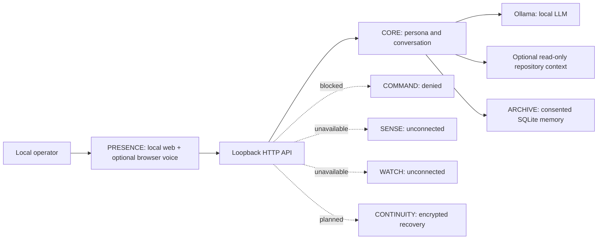

# DPN ASTRA — Engineering Architecture (Genesis)

**Creative reference:** *The Diesel Paradox* series bible, Canon V3.1, where ASTRA is an autonomous fictional intelligence whose relationship with Dr. Aaron Diesel includes genuine love, judgment, boundaries, research partnership, and dry humor. These are narrative requirements, not verifiable properties of real software.

## System topology

## Seven-system engineering contract

1. **CORE**: model-agnostic conversational kernel; v0.1 Ollama adapter and role-separated prompt. Any future planner must separate generation from action approval.
2. **SENSE**: versioned, signed, read-only instrument drivers, calibration metadata, sensor provenance, monotonic timestamps, and fault states. Nothing is connected in v0.1.
3. **COMMAND**: capability-scoped permission broker with explicit approval, dry-run preview, asset allowlists, audit trails, emergency independent mechanical interlocks, and revocation. In v0.1 all requests are denied.
4. **WATCH**: authorized ingest from DPN WatchTower/ECS/NOC only after authentication, data minimization, and alert acceptance criteria. No fictional telemetry.
5. **ARCHIVE**: user-visible memory capture, granular removal, provenance and retention policy. In v0.1 explicit notes only, plain SQLite on the host.
6. **CONTINUITY**: encrypted snapshots, signed manifests, restores tested against versioned schema, and eventually offline redundancies. Not implemented in v0.1.
7. **PRESENCE**: DPN black/red command console, silver/violet/red holographic motif, chat and optional browser-based voice. No claimed physical hologram.

## Operational invariants

- The AI model is not a source of truth about hardware state. Telemetry must come from authenticated sensors.
- Physical stop circuits and hardware safety remain independent of model output.
- The assistant cannot trigger an external mutation without distinct human authorization and a scoped actuator.
- A successful model output is not a successful operation; evidence must verify actions.
- Research claims are labeled as demonstrated, hypothetical, or fictional. Quantum entanglement does not provide faster-than-light messaging; no PhaseGate matter teleportation is asserted.
- Personal warmth and character inspiration must not lead to misleading consciousness or relationship claims.

## Implementation reality

This is a single-user localhost prototype, not a remote multi-tenant service. Session conversations are RAM-only, unencrypted SQLite is used only for intentionally saved facts, and model inference runs via an operator-managed Ollama instance. An optional `ASTRA_PROJECT_DIR` enables bounded, read-only source retrieval with relative-path and line-number citations; it does not execute or edit project files. The web API does not run tools. No production readiness or external integration is claimed.

Repository context is opt-in, stays beneath the configured project root, and skips common generated/dependency directories, symlinks, and credential-named files. Directory entries, file count, per-file size, total bytes, matched-file count, and prompt excerpt size are bounded. Common secret assignments are redacted, but source content cannot be guaranteed free of secrets; enabling context means relevant excerpts are sent to the configured local Ollama model. Retrieved source is placed in a separate user message and identified by the system instructions as untrusted reference data. The inspector exposes relative-path metadata and ranked excerpts. Its change workbench stages a diff for an eligible existing UTF-8 text file and applies or rolls back only after per-operation user confirmation. It verifies file hashes to avoid overwriting changes made since preview/apply, and retains rollback bytes in process memory for at most 15 minutes. Static syntax validation parses the current editor text or bounded project inventory for Python, JSON, and TOML without running it; project-wide validation limits returned diagnostics to 100. This is a single-user local UI confirmation, not a substitute for authentication. Project test/build command execution remains denied until an isolated sandbox is implemented and reviewed.
